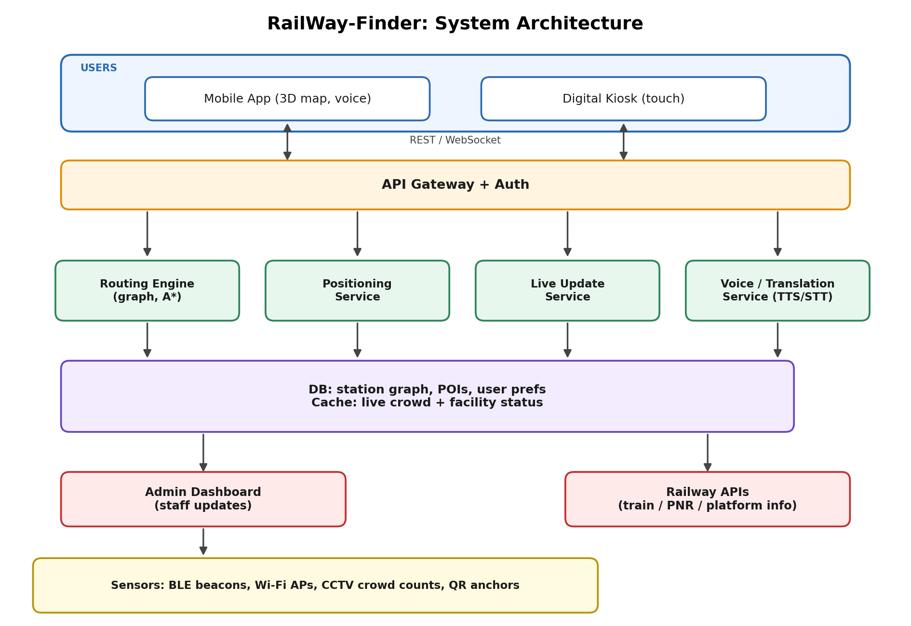
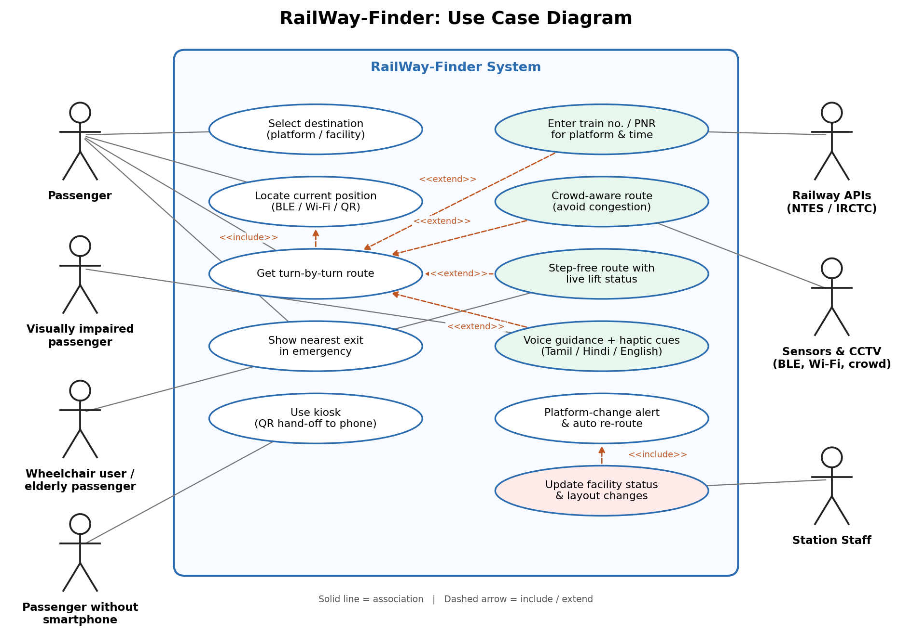

# Smart India Hackathon Workshop
# Date:30-10-2026
## Register Number:212224040064
## Name:Dhamini S
## Problem Title
SIH 1710: Enhancing Navigation for Railway Station Facilities and Locations
## Problem Description
Background: Railway stations are complex environments with numerous facilities and locations such as ticket counters, platforms, restrooms, food courts, and waiting areas. Passengers often face difficulties in navigating these spaces, especially in large or unfamiliar stations. Efficient and user-friendly navigation systems are crucial for improving passenger experience, reducing congestion, and ensuring timely travel connections. Description: The problem involves developing a comprehensive navigation solution for railway stations that assists passengers in locating various facilities and destinations within the station premises. This includes creating detailed maps, providing real-time directions, and integrating features such as accessibility options for individuals with disabilities. The solution should be intuitive, easy to use, and accessible via multiple platforms, including mobile devices and digital kiosks. Key challenges include updating navigation information in real-time, ensuring accuracy, and accommodating the diverse needs of all passengers. Expected Solution: The expected solution is a multi-platform navigation system that provides detailed, real-time directions to all facilities and locations within a railway station. This system should include: A mobile application with 3D interactive maps and step-by-step navigation. Digital kiosks located throughout the station with touch-screen interfaces. Voice-guided navigation for visually impaired passengers. Regular updates to reflect changes in station layout and facility locations. Integration with existing railway apps and services for seamless user experience. The solution should enhance the overall passenger experience by reducing confusion, saving time, and improving accessibility within the station.

## Problem Creater's Organization
Ministry of Railway

## Idea

RailWay-Finder is one navigation system for a station that works on three surfaces: a mobile app, digital kiosks, and a voice-first mode for visually impaired passengers.

It works like Google Maps for the inside of a station. You pick a destination (Platform 5, restroom, food court, ticket counter) and it guides you step by step. Three things make it different:

Train-aware: it knows your train and platform from the PNR or train number, so it tells you where to go and how long you have.
Crowd-aware and accessible: it avoids congested paths and offers step-free routes for wheelchair users, elderly passengers and people with luggage.
Always works: it falls back to QR codes and offline maps when GPS, Wi-Fi or the internet fails.

## Proposed Solution / Architecture Diagram

1. Digital map: The station is stored as a graph. Entrances, stairs, lifts, platforms and facilities are nodes, and walkable paths are edges with distance, step-free flag and crowd level.

2. Positioning: BLE beacons find the passenger’s location, with Wi-Fi and QR “You are here” codes as backup.

3. Routing: An A* engine finds the shortest, step-free or least crowded path.

4. Train-aware guidance: The passenger enters a train number or PNR, and the system fetches the platform and departure time, guides them there, and re-routes if the platform changes.

5. Live updates: Station staff mark lift breakdowns, blocked paths or platform changes on an admin dashboard, and all apps and kiosks update within seconds. Crowd levels come from CCTV people counting.

6. Interfaces: A mobile app with a 3D map, kiosks with QR hand-off to the phone, and voice guidance in Tamil, Hindi and English for visually impaired passengers.

7. Offline and emergency: Maps are cached on the phone and QR codes work without internet. In an emergency, the app shows the nearest exit.

Architecture flow: Users (mobile app, kiosk) → API Gateway → Routing, Positioning, Live Update and Voice services → Database and cache. The admin dashboard, Railway APIs and sensors (BLE, Wi-Fi, CCTV, QR) feed data into the system.

## Use Cases

## Technology Stack

Mobile app: Flutter

3D maps: Mapbox

Kiosk UI: React.js

Backend: Node.js (Express)

Routing: A* algorithm

Database: PostgreSQL (PostGIS)

Cache: Redis

Real-time updates: WebSockets

Positioning: BLE beacons

Voice: Google TTS

Crowd estimation: OpenCV

Admin dashboard: React.js

Deployment: AWS

## Dependencies

Station floor plans from Indian Railways (or a manual survey)

Railway APIs (NTES / IRCTC) for train and platform data, which need approval, so the prototype uses sample data

Hardware: BLE beacons, kiosks, Wi-Fi, optional CCTV feeds

Station staff to update facility status

Permission to install QR codes, beacons and kiosks

Cloud hosting, TTS and push notification services

DPDP Act 2023 privacy compliance

Accessibility testing with real users